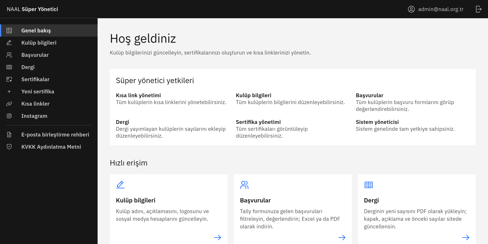

[](https://app.netlify.com/projects/nevzatayaz-admin/deploys)
# NAAL Club Admin Panel

The admin panel of the school-wide club platform of Nevzat Ayaz Anatolian High School ([naal.org.tr](https://naal.org.tr)). Club officers and advisors sign in with their school Google account to manage their club's public page, certificates, short URLs, Instagram feed, applications and (for magazine clubs) its magazine. Super admins manage every club. Access comes from the school directory ([naal-directory](https://github.com/naaltech/naal-directory)), so nobody needs a separate account. The UI is in Turkish.



## 🚀 Features

- **Certificates**: Create digital certificates, upload PDFs, export lists to Excel, or paste an attendance list: the directory checks each person, writes the official name on the certificate and emails the verification link to their school address
- **Club information**: Edit the club profile, logo, description and links, including the WhatsApp community link
- **Short URLs**: `<club code>.naal.org.tr/<path>` redirects, with availability checks
- **Instagram**: Connect Business/Creator accounts through the official Instagram API; posts are synced every 20 minutes and their images stored as WebP on the `naal-files` service
- **Applications**: Review Tally application forms, mark submissions as accepted/rejected, add notes, export, and email results to applicants
- **Magazine**: Publish magazine issues (PDF up to 50 MB, cover rendered from the first page) and name magazine editors from the school directory
- **Role-based access**: `panel_roles` is written by the directory: super admins, club leads (president, vice president, advisor) and magazine editors, enforced by Supabase RLS. People who lead several clubs switch between them in the header
- **KVKK pages**: Public privacy notice (`/gizlilik`) and data deletion instructions (`/veri-silme`)

## 🛠️ Technologies

- **Framework**: Next.js 16 (App Router, webpack build), React 19, TypeScript
- **UI**: IBM Carbon (`@carbon/react`), Sass, IBM Plex
- **Backend**: Supabase (Auth, Postgres with RLS, Storage, Edge Functions)
- **Storage**: `naal-files`, our own file service, for Instagram images (`sharp`) and certificate PDFs
- **Other**: `pdfjs-dist`, `jspdf`, `write-excel-file`
- **Deployment**: Netlify (every push to `main` goes to production)

> Next.js 16 has breaking changes compared to older versions (for example `middleware.ts` became `proxy.ts`). See `node_modules/next/dist/docs/` before changing framework code.

## 📋 Requirements

- Node.js 20+
- pnpm (or npm)
- A Supabase project

## 🏃‍♂️ Installation

1. **Clone the project:**
```bash
git clone https://github.com/naaltech/naal-org-admin.git
cd naal-org-admin
```

2. **Install dependencies:**
```bash
pnpm install
```

3. **Set environment variables:**
Copy `.env.example` to `.env.local` and fill it in (see [Environment variables](#environment-variables)).

4. **Set up the database:**

The schemas are applied by hand in the Supabase SQL Editor; there are no migrations. Run the files in `supabase/` in this order, then follow [`supabase/pending/README.md`](supabase/pending/README.md) (Google sign-in and directory roles; **not applied to the live project yet**):

| File | Purpose |
|------|---------|
| `schema.sql` | Base tables (`clubs`, `cert`, `cert_pdf`, `url`, `posts_instagram`) |
| `policies.sql` | Row level security for the base tables |
| `storage.sql` | Public `club-logos` bucket and its policies |
| `instagram.sql` | `instagram_accounts` (tokens, service role only) and the new `posts_instagram` columns |
| `applications.sql` | `club_forms` and `application_reviews` |
| `application-notify.sql` | Notification tracking for application result emails |
| `club-settings.sql` | `club_settings` (private per club, e.g. WhatsApp link) |
| `magazines.sql` | `magazines` table and the public `magazines` bucket |
| `editors.sql` | `club_editors`; dropped again by `pending/02-cutover.sql` |

5. **Set up the Instagram integration (optional):**

Club posts are fetched with the official [Instagram API with Instagram Login](https://developers.facebook.com/docs/instagram-platform/instagram-api-with-instagram-login) and their images are stored on the `naal-files` service as WebP.

- Create a Meta app with the Instagram product, add `<site>/api/instagram/callback` as the OAuth redirect URI and set `INSTAGRAM_APP_ID` / `INSTAGRAM_APP_SECRET`. While the app is in development mode, each club's Instagram account must be added as an Instagram tester in the app.
- Install `naal-files` (see its README) and set `FILES_URL` and `FILES_TOKEN`.
- Set `SUPABASE_SERVICE_ROLE_KEY` and a random `CRON_SECRET`. On Netlify, `netlify/functions/instagram-sync.ts` calls `/api/instagram/cron` every 20 minutes; elsewhere, call it from any cron service with `Authorization: Bearer <CRON_SECRET>`.
- Club accounts must be Instagram **Business** or **Creator** accounts. Connect them from the **Instagram** page of the panel.
- Meta app URLs: Privacy Policy `https://admin.naal.org.tr/gizlilik`, Deauthorize callback `https://admin.naal.org.tr/api/instagram/deauthorize`, Data deletion request `https://admin.naal.org.tr/api/instagram/data-deletion`.

6. **Set up club applications (optional):**

Clubs review the submissions of their Tally application forms on the **Başvurular** page. Submissions stay in Tally; the panel reads and deletes them through the `tally-applications` Supabase Edge Function, so the Tally API key never reaches Netlify or the browser.

- Run `applications.sql`, deploy `supabase/functions/tally-applications` and add the Tally API key as the Edge Function secret `TALLY_API_KEY`.
- Link a form to a club with **Form bağla** on the **Başvurular** page (super admins only). Tick the membership option only on membership forms: accepted applicants of those forms are enrolled in the club through the directory.
- Run `club-settings.sql` so clubs can set a WhatsApp community link on the **Kulüp bilgileri** page. It is added to acceptance emails.
- To email results to applicants, run `application-notify.sql`, add the Google Workspace SMTP account as the Edge Function secrets `SMTP_HOST`, `SMTP_USER` and `SMTP_PASSWORD` (an app password). Edge Functions cannot reach ports 25 and 587, so the function always uses port 465. Results are sent from `basvuru@naal.org.tr` after the club confirms a preview of the email.

7. **Set up the club magazine (optional):**

Clubs listed in `MAGAZINE_CLUBS` (`lib/roles.ts`, currently `bilim`) publish their magazine issues on the **Dergi** page. The club site shows the highest published issue as the current one and lists the others as previous issues.

- Run `magazines.sql`.
- Clubs add editors from the **Dergi** page by school email. The request goes to the directory through `directory_commands` and is processed within a minute; the directory checks the person and writes the role. Editors sign in with their school Google account and can only reach the **Dergi** page. Their access ends by itself when they leave the school.

8. **Start the development server:**
```bash
pnpm dev
```

The application will run at [http://localhost:3000](http://localhost:3000).

## 📜 Scripts

| Script | Description |
|--------|-------------|
| `pnpm dev` | Development server (webpack) |
| `pnpm build` | Production build (`next build --webpack`) |
| `pnpm start` | Start the production server |
| `pnpm lint` | ESLint |
| `pnpm typecheck` | `tsc --noEmit` |

## 📁 Project Structure

```
├── app/
│   ├── (app)/              # Signed-in pages (app shell)
│   │   ├── dashboard/      # Overview
│   │   ├── club-info/      # Club profile and logo
│   │   ├── applications/   # Tally applications
│   │   ├── magazine/       # Magazine issues and editors
│   │   ├── certificates/   # Certificate list and create/
│   │   ├── urls/manage/    # Short URLs
│   │   └── instagram/      # Instagram connection
│   ├── api/
│   │   ├── instagram/      # connect, callback, sync, cron, deauthorize, data-deletion, accounts
│   │   ├── upload/         # PDF upload (naal-files)
│   │   └── urls/check/     # Short URL availability
│   ├── login/              # Google sign-in
│   ├── gizlilik/           # KVKK privacy notice
│   └── veri-silme/         # Data deletion instructions
├── components/             # Carbon based shared components
├── contexts/               # Auth and toast contexts
├── hooks/                  # Custom hooks
├── lib/                    # Supabase clients, roles, Instagram, files, uploads, exports
├── netlify/functions/      # Scheduled Instagram sync
├── scripts/                # One-off maintenance scripts
├── supabase/               # SQL files and Edge Functions
└── public/                 # Static files and fonts
```

## 🔧 Configuration

### Environment variables

| Variable | Description |
|----------|-------------|
| `NEXT_PUBLIC_SUPABASE_URL` | Supabase project URL |
| `NEXT_PUBLIC_SUPABASE_ANON_KEY` | Supabase anonymous API key |
| `SUPABASE_SERVICE_ROLE_KEY` | Supabase service role key (server only, never use a `NEXT_PUBLIC_` prefix) |
| `INSTAGRAM_APP_ID` / `INSTAGRAM_APP_SECRET` | Meta app credentials for Instagram Login |
| `INSTAGRAM_REDIRECT_URI` | Optional OAuth redirect override |
| `FILES_URL`, `FILES_TOKEN` | `naal-files` service for Instagram images and certificate PDFs |
| `CRON_SECRET` | Secret for the scheduled Instagram sync |

Edge Function secrets (`TALLY_API_KEY`, `SMTP_HOST`, `SMTP_USER`, `SMTP_PASSWORD`) are set in Supabase, not in Netlify.

## 🚀 Deployment

The site is linked to its GitHub repository through Netlify's Git integration: every push to `main` builds and deploys to production at `admin.naal.org.tr` (and the `dash`, `dashboard`, `manage`, `yonet`, `yonetici` aliases). Run `pnpm build`, `pnpm lint` and `pnpm typecheck` locally before pushing.

### Manual Deployment

```bash
pnpm build
pnpm start
```

### Supabase

Edge Functions deploy from CI when `supabase/functions/**` changes on `main`. To enable it, add a Supabase access token as the Actions secret `SUPABASE_ACCESS_TOKEN`, then set the repository variables `SUPABASE_PROJECT_ID` and `SUPABASE_DEPLOY_ENABLED=true`. Function secrets (`TALLY_API_KEY`, `SMTP_*`) stay in Supabase.

Database changes are still applied by hand. To move them to versioned migrations, link the project and capture the live schema as the baseline first, so that existing tables are not created twice:

```bash
npx supabase link --project-ref <project id>
npx supabase db pull
```

Review the generated file in `supabase/migrations/`, then replace the file list in the installation steps with `supabase db push`.

## 📄 License

This project is licensed under the GPLv3 License. See the `LICENSE` file for details.
